# Shivam Jangid — AI Engineer & Full-Stack Developer Portfolio

An immersive, highly-optimized single-page portfolio designed to showcase advanced AI engineering, scalable system architecture, and full-stack development expertise. Built with a developer-centric "Terminal Noir" aesthetic.

---

## 🎯 Overview

This repository is not just a static portfolio; it is a full-stack, AI-powered web application. It demonstrates an obsession with performance, clean architectural boundaries, and the integration of Large Language Models (LLMs) into production-ready features.

The system features two primary AI tools:
1. **Vectorless RAG Repo Explainer**: An intelligent agent capable of analyzing large GitHub repositories and answering follow-up questions.
2. **Resume Analyser**: An automated pipeline to parse, score, and recommend improvements for resumes.

---

## 🧠 AI Capabilities Engine

### The Vectorless RAG Architecture (Repo Explainer)

The Repo Explainer abandons traditional Vector DB chunk-and-retrieve methods in favor of **Vectorless RAG**. By eagerly fetching structural metadata and injecting a truncated, formatted file tree directly into the LLM's context window, the AI gains a comprehensive architectural understanding of the codebase in a single shot. 

For follow-up questions, it utilizes an autonomous decision loop to fetch on-demand data from GitHub APIs if its current context is insufficient.

```mermaid
sequenceDiagram
    autonumber
    participant User
    participant UI as Frontend (React)
    participant API as Backend (FastAPI)
    participant GitHub as GitHub API
    participant LLM as LLM Engine

    User->>UI: Submit GitHub URL
    UI->>API: POST /repo-explain
    
    rect rgb(20, 30, 40)
    Note over API,GitHub: Phase 1: Eager Synthesis
    API->>GitHub: Fetch Metadata, Languages, Commits, File Tree
    GitHub-->>API: Repo Structural Context
    API->>LLM: Prompt (Tree + Meta) -> Synthesize JSON
    LLM-->>API: Structured Architecture Analysis
    end
    
    API-->>UI: Display Analysis Results & Init Session

    User->>UI: Ask Follow-up Question
    UI->>API: POST /repo-explain/ask
    
    rect rgb(30, 20, 30)
    Note over API,LLM: Phase 2: Autonomous On-Demand Fetch
    API->>LLM: "Do you need more data to answer?"
    alt Needs Data
        LLM-->>API: Request specific endpoint (e.g., Pull Requests)
        API->>GitHub: Fetch On-Demand Data
        GitHub-->>API: Fresh Context
        API->>LLM: Synthesize Answer (History + New Context)
    else Has Enough Context
        API->>LLM: Synthesize Answer (History + Existing Context)
    end
    LLM-->>API: Final Output
    end
    
    API-->>UI: Display Answer
```



### Resume Analyser
A secure pipeline that handles multiple file formats (PDF, DOCX, Images). It parses the content and passes it through a structured evaluation prompt to score the candidate across multiple dimensions, returning actionable, specific feedback.

---

## 🏗️ Tech Stack

### Frontend (Extreme Performance & Aesthetic)
* **Core**: React 18, TypeScript, Vite
* **Styling & Theming**: Tailwind CSS, Custom CSS-variable driven theme system (`terminal-noir`, `ocean-blue`, `sleek-minimal`, etc.)
* **State Management**: Zustand (Persistent State)
* **Animations**: Framer Motion (Declarative layout), GSAP (Scroll timelines), Lenis (Smooth scrolling)
* **Routing**: React Router DOM

### Backend (Scalability & LLM Orchestration)
* **Core**: FastAPI, Python 3.11+
* **Concurrency**: `asyncio` & `httpx` for high-throughput, non-blocking GitHub API fetching
* **AI Integration**: LangChain (Message structuring, Tool Calling)
* **Resilience**: Custom rate limiting (`slowapi`), distributed caching for concurrent redundant requests, and graceful timeout fallbacks for massive repositories.

---

## 📁 System Architecture & Directory Structure

The application separates concerns strictly between the UI presentation layer and the API/LLM orchestration layer.

```text
myPortfolio/
├── frontend/               # React SPA
│   ├── src/
│   │   ├── components/     # Stateless UI (Buttons, Terminal, ThemeSwitcher)
│   │   ├── config/         # Centralized registry (Projects, AI Tools)
│   │   ├── hooks/          # Custom hooks (useTheme, useReducedMotion)
│   │   ├── sections/       # Modular Landing Page Sections
│   │   ├── stores/         # Zustand global stores
│   │   └── styles/         # CSS variables & Tailwind config
│   └── package.json        
└── backend/                # FastAPI Microservice
    ├── api/                # API Routers (Health checks)
    ├── llm/                # LLM orchestration and prompt engineering
    ├── middleware/         # Rate limiters, CORS, request tracking
    ├── services/           # Business logic (GitHub API client, RAG loops)
    └── main.py             # Uvicorn entry point
```

---

## 🚀 Running Locally

### Prerequisites
* Node.js (v18+)
* Python (3.11+)
* A GitHub Personal Access Token (for extended rate limits)
* An LLM API Key (e.g., OpenAI/Gemini)

### 1. Start the Backend
```bash
cd backend
python -m venv .venv
source .venv/bin/activate  # Or .venv\Scripts\activate on Windows
pip install -r requirements.txt

# Create a .env file based on .env.example and add your API keys
cp .env.example .env

# Run the server
uvicorn main:app --reload --port 8000
```

### 2. Start the Frontend
```bash
cd frontend
npm install

# Run the dev server
npm run dev
```

The frontend will be available at `http://localhost:5173`. Ensure the `VITE_API_BASE_URL` in your frontend environment points to the backend server.

---

## 🤝 Why Hire Me?

I don't just write code; I engineer resilient, scalable systems that solve real problems.
- **AI-Native Approach**: I build LLM integrations that go beyond simple wrappers. I design custom orchestration loops (like Vectorless RAG) to handle context limits, prevent hallucination, and reduce token latency.
- **Full-Stack Competency**: From writing buttery-smooth GSAP animations on the frontend to profiling async HTTP client timeouts on the FastAPI backend, I own the entire lifecycle of a feature.
- **Performance Obsessed**: I anticipate failure states (e.g., handling massive Linux-kernel sized repos without crashing) and gracefully degrade functionality to ensure a seamless user experience.

*Let's build something extraordinary together.*
